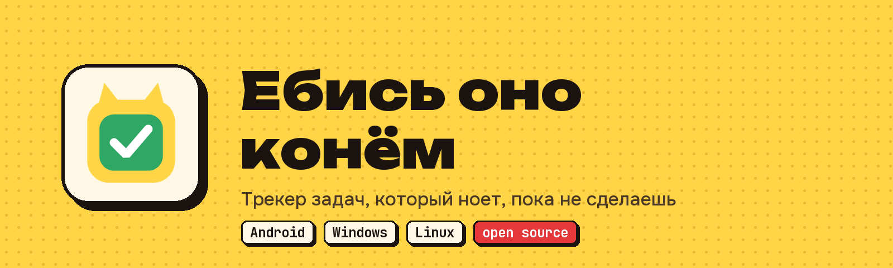
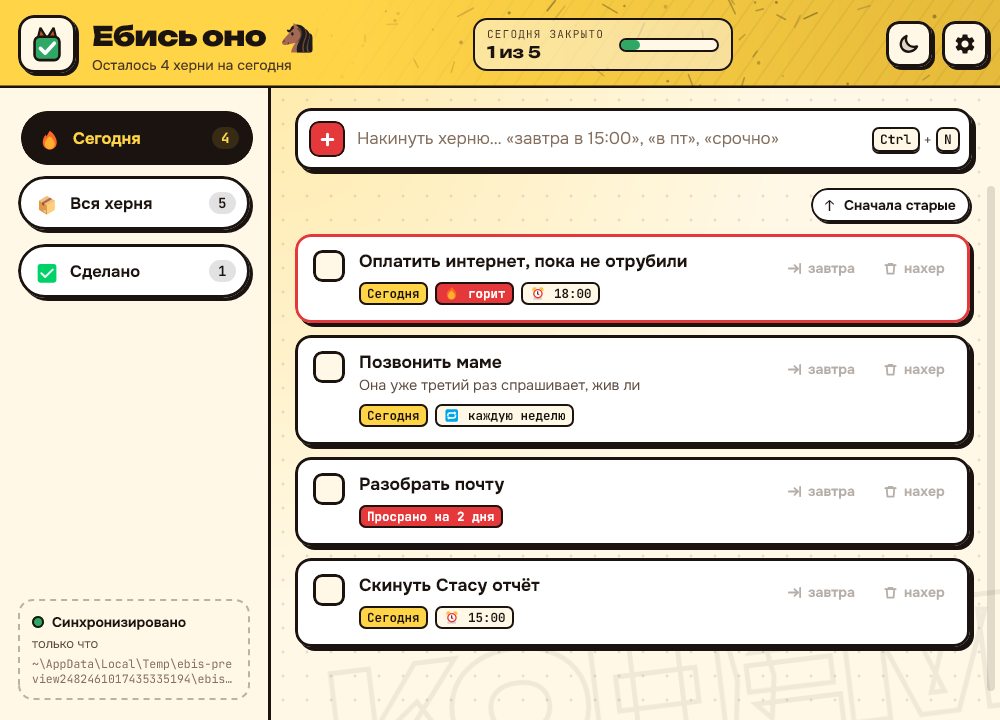
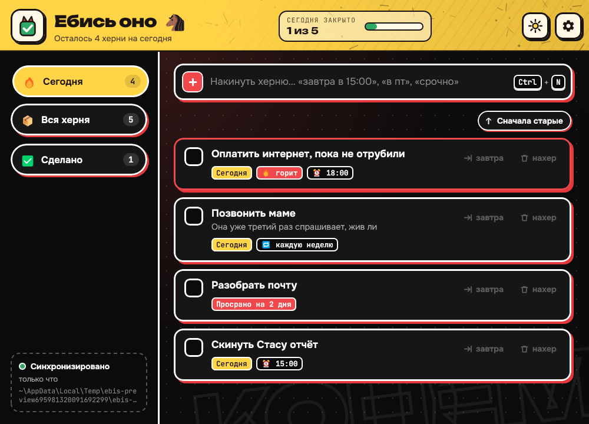
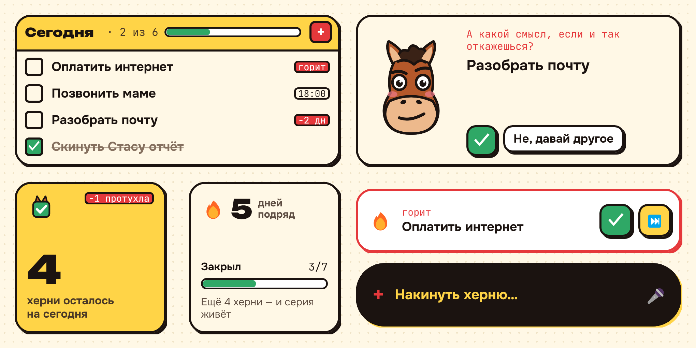

<p align="center">
  
</p>

<p align="center">
  <a href="https://github.com/pluusultra/ebis-ono-konem/releases/latest"></a>
  <a href="https://github.com/pluusultra/ebis-ono-konem/releases"></a>
  <a href="LICENSE"></a>
</p>

<p align="center">
  <b>A task tracker that doesn't mince words.</b><br>
  It nags, reminds and shames you until stuff gets done. No accounts, no servers, no internet.<br>
  Android · Windows · Linux · <a href="README.md">Русский</a>
</p>

---

<p align="center">
  
  
</p>

**«Ебись оно конём»** (*ebis' ono konyom*) is a Russian idiom roughly meaning *"screw it all, let the horse deal with it"* —
exactly what you say about the task that has been rotting on your list for three weeks. This app is the horse.

> The interface is in Russian, and intentionally rude. That's the whole point.

## Features

- **Natural-language input** (Russian): «завтра в 15:00», «в пт», «каждый понедельник», «срочно» → date, time, repeat and priority are parsed automatically.
- **Notifications that won't let go**: morning kick, afternoon nagging, a daily "wall of shame" for the most overdue task, evening summary, per-task reminders.
- **Alarm for hot tasks**: full-screen, looping melody (yes, balalaika) until you answer.
- **Android**: 6 home-screen widgets, AMOLED night theme, swipe gestures, backup to JSON.
- **Windows & Linux**: same look, lives in the tray, native notifications with action buttons, rebindable hotkeys, themes.
- **Private by design**: the Android app has **no internet permission** at all. Your tasks are a single JSON file on your device.
- **Phone ↔ PC sync** through any folder you already sync (Syncthing, a cloud drive…), with per-task merging.

<p align="center">
  
</p>

## Download

Grab the files from the **[latest release](https://github.com/pluusultra/ebis-ono-konem/releases/latest)**:

| Platform | File |
|---|---|
| 📱 Android 8.0+ | `ebis-ono-konem-X.Y.Z.apk` |
| 🪟 Windows 10/11 | `EbisOnoKonem-X.Y.Z-windows-x64-setup.exe` (no admin rights needed) or `…-portable.zip` |
| 🐧 Linux, any distro | `EbisOnoKonem-X.Y.Z-linux-x86_64.AppImage` |
| 🐧 Debian / Ubuntu | `ebis-ono-konem_X.Y.Z_amd64.deb` |
| 🐧 Fedora / openSUSE | `ebis-ono-konem-X.Y.Z.x86_64.rpm` |
| ☕ Anything with Java 17+ | `…-universal.jar` |

Java is bundled in every package except the `.jar`.

## Building

Kotlin + Jetpack Compose (Android) + Compose Multiplatform (desktop), shared code in `shared/`.

```sh
./gradlew :desktop:run          # desktop app (JDK 17+)
./gradlew :app:assembleDebug    # Android (Android SDK)
./gradlew :shared:test :desktop:test
```

Details (in Russian): [docs/BUILDING.md](docs/BUILDING.md).

## License

[MIT](LICENSE). Bundled fonts are under their own open licenses (SIL OFL / Apache 2.0).
