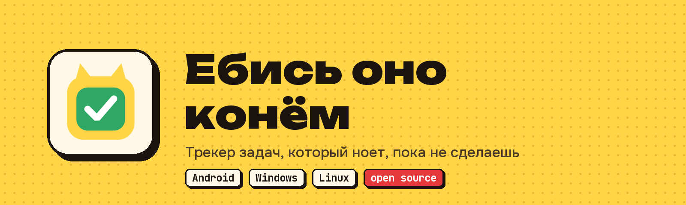
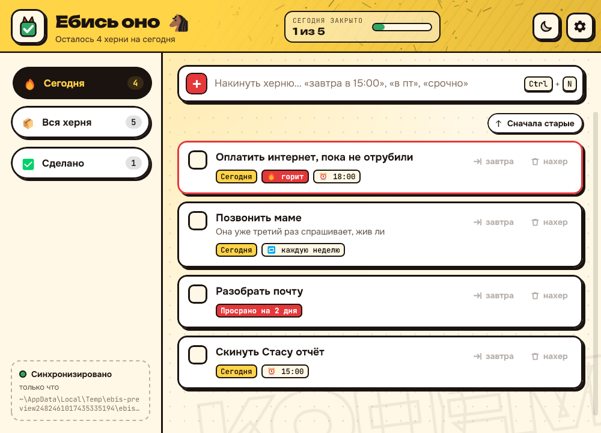
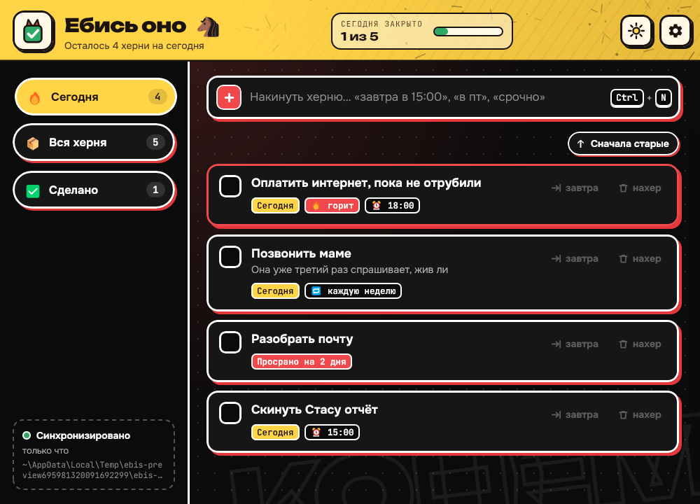
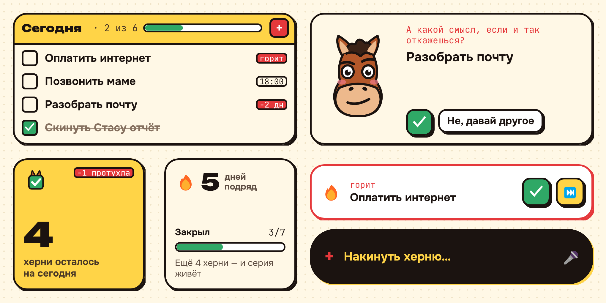
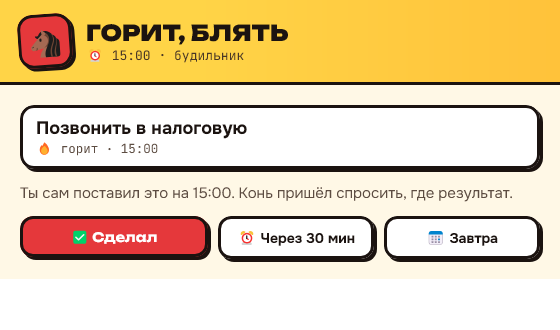
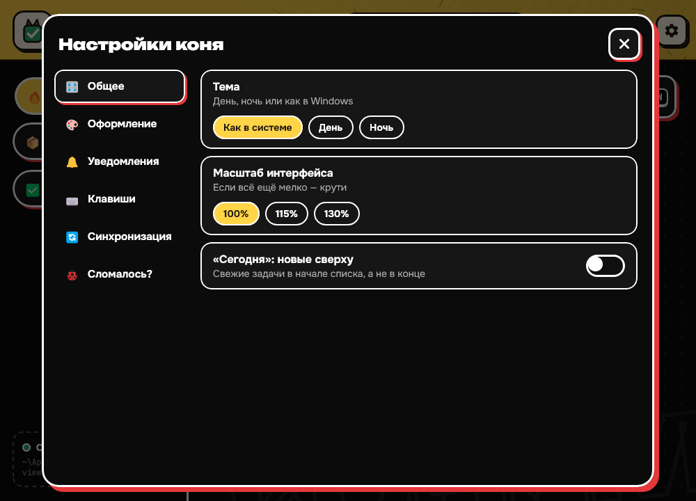

<p align="center">
  
</p>

<p align="center">
  <a href="https://github.com/pluusultra/ebis-ono-konem/releases/latest"></a>
  <a href="https://github.com/pluusultra/ebis-ono-konem/releases"></a>
  <a href="LICENSE"></a>
  <a href="https://github.com/pluusultra/ebis-ono-konem/actions/workflows/ci.yml"></a>
</p>

<p align="center">
  <b>Трекер задач, который не стесняется в выражениях.</b><br>
  Ноет, напоминает и стыдит, пока не сделаешь. Без аккаунтов, без серверов, без интернета.<br>
  Android · Windows · Linux
</p>

<p align="center">
  <a href="#скачать"><b>⬇ Скачать</b></a> ·
  <a href="#что-умеет">Что умеет</a> ·
  <a href="#синхронизация-телефона-и-пк">Синхронизация</a> ·
  <a href="#сборка-из-исходников">Сборка</a> ·
  <a href="README.en.md">English</a>
</p>

---

<p align="center">
  
  
</p>

## Зачем

Обычные таск-трекеры вежливые. Вежливость не работает: задача «оплатить интернет» висит третью неделю,
а приложение деликатно показывает серую точку.

«Ебись оно конём» — наоборот. Утром пинает, днём ноет про самую старую задачу, в 11:00 ставит к позорному столбу
самую протухшую, вечером подводит итог. Горящая задача включает будильник с балалайкой и не замолкает, пока
не ответишь. Зато когда закрыл всё на сегодня — конь искренне рад.

## Что умеет

**📝 Задачи без лишних кнопок**
- Пишешь как человек: «оплатить интернет **завтра в 15:00**», «отчёт **в пт**», «спортзал **каждый понедельник**», «**срочно** позвонить» — дата, время, повтор и «горит» разбираются сами.
- Вкладки «Сегодня», «Вся херня» (Просрано / Сегодня / Завтра / На неделе / Потом) и «Сделано» с серией дней и рекордом.
- Повторы: каждый день, по будням, раз в неделю, раз в месяц или по выбранным дням недели.
- Цветные теги, фильтр и быстрый ввод вроде `проверить счёт завтра #дом`. После `#` появляются подсказки.
- Поиск по названию, описанию и тегам во всех вкладках. В задачу можно добавить чек-лист, а просроченные задачи обработать разом.
- Свайп вправо — сделал, влево — на завтра. «Верни» после любого действия.

**🔔 Напоминания, от которых не отвертишься**
- Утренний пинок, дневное нытьё (до трёх раз), позорный столб, вечерний итог — время настраивается.
- Напоминалка на время задачи с кнопками «Сделал» / «Через час» / «Завтра».
- **Будильник для горящих задач**: на весь экран, мелодия по кругу (балалайка, галоп, «король», деревня) — пока не нажмёшь.

**📱 Android**
- 6 виджетов: список на сегодня, счётчик, серия, горящая задача, быстрый ввод с микрофоном и «случайная херня» с конём.
- Ночная AMOLED-тема, анимации на пружинках, ярлык «Накинуть» на иконке, «Поделиться» текстом из любого приложения.
- Бэкап в JSON и обратно, с локальной копией перед импортом и корзиной для задач и тегов.

**🖥 Windows и Linux**
- Тот же вид, те же шрифты и тот же конь. Живёт в трее, запускается вместе с системой.
- Нативные уведомления Windows с кнопками; на Linux — через `notify-send`, трей по StatusNotifierItem (KDE, GNOME с AppIndicator, XFCE, Cinnamon).
- `Ctrl+N` из любого места окна, переназначаемые горячие клавиши, свой узор и цвет фона, шрифт, масштаб.
- `Ctrl+F` открывает поиск. Бэкап и корзина находятся в общих настройках.

**🔒 Приватность**
- У Android-приложения **нет разрешения на интернет** — оно физически не может никуда ничего отправить.
- Задачи лежат в одном JSON-файле у тебя. Никаких аккаунтов, аналитики и рекламы.

<p align="center">
  
</p>

<p align="center">
  
  
</p>

## Скачать

Все файлы — на странице **[последнего релиза](https://github.com/pluusultra/ebis-ono-konem/releases/latest)**.

| Система | Что качать | Как ставить |
|---|---|---|
| 📱 **Android** 8.0+ | `ebis-ono-konem-X.Y.Z.apk` | Открыть файл на телефоне, разрешить установку из этого источника. Новые версии ставятся поверх. |
| 🪟 **Windows** 10/11 | `EbisOnoKonem-X.Y.Z-windows-x64-setup.exe` | Запустить установщик. Права администратора не нужны, обновление ставится поверх. |
| 🪟 Windows без установки | `…-windows-x64-portable.zip` | Распаковать куда угодно, запустить `EbisOnoKonem.exe`. |
| 🐧 **Linux**, любой дистрибутив | `EbisOnoKonem-X.Y.Z-linux-x86_64.AppImage` | `chmod +x EbisOnoKonem-*.AppImage` и запустить. |
| 🐧 Ubuntu / Debian / Mint | `ebis-ono-konem_X.Y.Z_amd64.deb` | Двойной клик или `sudo apt install ./ebis-ono-konem_*.deb` |
| 🐧 Fedora / openSUSE | `ebis-ono-konem-X.Y.Z.x86_64.rpm` | `sudo dnf install ./ebis-ono-konem-*.rpm` |
| 🐧 Linux без root | `…-linux-x64.tar.gz` | Распаковать, запустить `./install.sh` — встанет в `~/.local`. |
| ☕ Что угодно с Java 17+ | `…-universal.jar` | `java -jar ebis-ono-konem-*-universal.jar` |

Java ставить не нужно — она уже внутри всех пакетов, кроме `.jar`.

> **Windows SmartScreen** может предупредить «Неизвестный издатель» — установщик не подписан платным сертификатом.
> Жми «Подробнее» → «Выполнить в любом случае». Проверить файл можно по `SHA256SUMS.txt` в релизе.

> На Linux для цветных эмодзи нужен шрифт Noto Color Emoji: `sudo apt install fonts-noto-color-emoji`.

## Синхронизация телефона и ПК

Своего сервера у приложения нет и не будет. Вместо него — любая папка, которую ты и так синхронизируешь:
[Syncthing](https://syncthing.net/), облачный диск, что угодно.

1. Телефон: Настройки → «🔄 Синхронизация с ПК» → «📁 Выбрать папку».
2. ПК: при первом запуске выбери ту же папку.

Обе стороны пишут в `ebis-tasks.json` после изменения. Например, если на телефоне поменять теги, а на ПК срок той же
задачи, сохранятся обе правки. При изменении одного поля побеждает более свежая правка. Удалённые задачи и теги
можно вернуть из корзины в течение 60 дней, конфликтные копии Syncthing вливаются сами.

## Сборка из исходников

Kotlin, Jetpack Compose (Android) и Compose Multiplatform (ПК). Общий код — в модуле `shared`.

```text
app/        Android-приложение
desktop/    ПК-версия: Windows и Linux
shared/     модель задач, формат файла, слияние, разбор быстрого ввода, тексты
packaging/  установщик Windows (Inno Setup), deb / AppImage / tar.gz для Linux
```

```sh
# ПК-версия (нужен JDK 17+)
./gradlew :desktop:run

# Android (нужен Android SDK)
./gradlew :app:assembleDebug

# Тесты
./gradlew :shared:test :desktop:test
```

Подробно — установщики, пакеты, подпись APK, как всё устроено: **[docs/BUILDING.md](docs/BUILDING.md)**.

## Участие

Баги и идеи — в [Issues](https://github.com/pluusultra/ebis-ono-konem/issues). Пулл-реквесты приветствуются,
см. [CONTRIBUTING.md](CONTRIBUTING.md). Тексты в приложении нарочно грубые — это фича, а не баг.

## Лицензия

[MIT](LICENSE). Шрифты (Unbounded, Onest, JetBrains Mono, Montserrat, Nunito, Roboto) — под своими открытыми
лицензиями (SIL OFL / Apache 2.0).

<p align="center"><sub>Сделано с ненавистью к прокрастинации. 🐴</sub></p>
